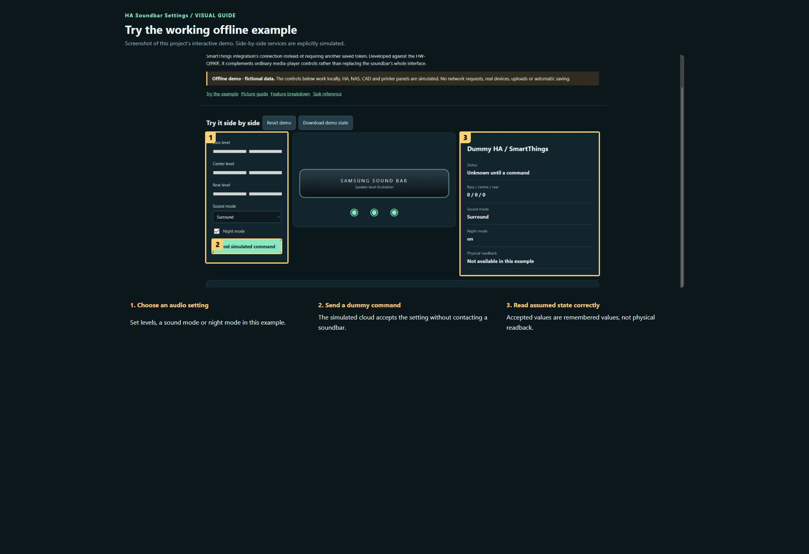

# HA Soundbar Settings

**Maintaining this project? [Start here](docs/START-HERE.md) · [Detailed handover](docs/HANDOVER.md)**

Expose selected advanced Samsung soundbar settings as native Home Assistant entities. It reuses the official SmartThings integration’s connection instead of requiring another saved token. Developed against the HW-Q990F, it complements ordinary media-player controls rather than replacing the soundbar’s whole interface.

[Publication checks and remaining limits](docs/PUBLICATION.md)

**Public source preview · MIT for original contributions.**

[Open the visual manual](docs/USER-MANUAL.md) · [Download the self-contained demo](demo.html) · [Release notes](CHANGELOG.md)

Download `demo.html` using GitHub’s Download raw file control, then open it in your browser. GitHub displays HTML source; it does not run the demo on this page. The demo is an offline simulation with fictional data and makes no network requests.

## See it

### Try the working offline example

Screenshot of this project’s interactive demo. Side-by-side services are explicitly simulated.

1. **Choose an audio setting.** Set levels, a sound mode or night mode in this example.
2. **Send a dummy command.** The simulated cloud accepts the setting without contacting a soundbar.
3. **Read assumed state correctly.** Accepted values are remembered values, not physical readback.

## What this tool does

| Feature | What it lets you do | Where |
| --- | --- | --- |
| Speaker levels | Bass/subwoofer, centre and rear levels: integer sliders from −6 to +6. | number entities |
| Sound mode | Standard, Surround, Game Pro and Adaptive Sound. | select entity |
| Audio switches | Bass boost, night mode and voice amplifier. | switch entities |
| Existing connection | Use the already configured HA SmartThings OAuth session. | Cloud dependency |
| Single-setting commands | Validate and send one setting per command; no automatic write retry. | Runtime behaviour |
| Assumed state | Show unknown initially and retain the last accepted setting; this is not physical readback. | Display limitation |

## A first useful workflow

### Find the controls

1. First confirm the soundbar already appears in the official SmartThings integration in HA.
2. Add Mungoon Soundbar Settings, choose the detected soundbar, and open its entities in Devices & services.
3. Add the relevant number, switch and select entities to a dashboard or use their entity controls directly. The integration itself does not provide a separate custom dashboard.

## Saving and outputs

Connection credentials remain with HA’s existing SmartThings integration. Entity restore retains accepted settings for display, but remembered values do not prove current hardware state. Internet access to SmartThings is required.

## Running the actual tool

Install under /config/custom_components/mungoon_soundbar, restart HA and add Mungoon Soundbar Settings.

The demo has no prerequisites; the real tool may need the services described in the manual and retained source notes.

## Current boundaries

Only the supported command payloads are promised. Other Samsung models require testing. Three command tests passed previously; no sound settings or physical-device tests were changed during this documentation work.

## Licence and sharing

MIT applies to original project contributions. Bundled/upstream software and assets retain their own terms; see [third-party notes](THIRD-PARTY.md). Keep this repository private until its own [release checklist](RELEASE-CHECKLIST.md) is complete and the owner authorises publication.

## Install the integration

Follow the retained [installation and setup guide](docs/soundbar-settings.md), then use the numbered screenshot manual above to understand the workflow.
