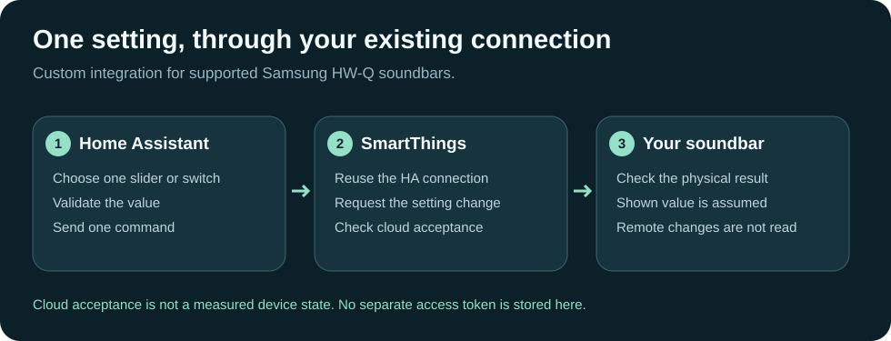

# HA Soundbar Settings: extra Samsung audio controls

[Numbered screenshot manual](USER-MANUAL.md) · [Try the offline example](../demo.html)

Add native Home Assistant sliders, switches and a sound-mode selector for
supported Samsung soundbars already connected through HA's SmartThings integration.
The implementation was developed against the HW-Q990F; other models need testing.

## Before you start

Your soundbar must already work through the official SmartThings integration in
HA. This component reuses that integration's existing OAuth connection; it does
not ask you to create another token. It needs Internet access to SmartThings.

## Install and use

1. Back up HA. Copy `projects-host/ha-custom-components/mungoon_soundbar` into
   HA's `/config/custom_components/` directory.
2. Check the HA configuration and restart HA.
3. Open **Settings → Devices & services → Add integration**. Select
   **Mungoon Soundbar Settings**, then choose the detected soundbar.
4. Open the added entities. Depending on this component's supported settings,
   you will find bass/subwoofer, centre and rear level sliders, sound modes,
   bass boost, night mode and voice amplifier switches.
5. Start with one setting at a time and check the actual soundbar response.
   Setup itself does not change an audio setting.

## Understand the displayed state

The tested soundbar did not return advanced setting values in read-only queries.
These entities therefore start unknown and remember only the last accepted
command. Their state is **assumed**. A SmartThings acceptance is not proof that
the physical setting changed. Changes made with the remote or Samsung app cannot
be read back through this component. Full graphic EQ is not provided.

## If the soundbar is missing or unavailable

Check that HA's official SmartThings integration is connected and the soundbar
appears there. Discovery requires suitable capabilities and a soundbar label or
HW-Q model identifier. If SmartThings is disconnected, reconnect it through HA's
normal interface. Never paste tokens into a public issue.

This custom integration depends on HA SmartThings runtime internals. HA upgrades
may require updates here. The source includes conservative value validation and
does not automatically retry writes; unsupported models are not promised to work.
